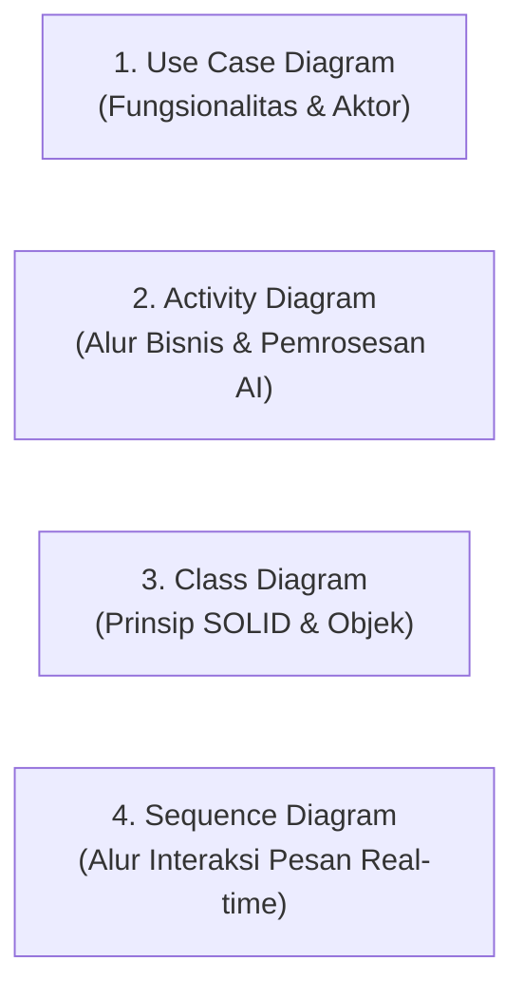
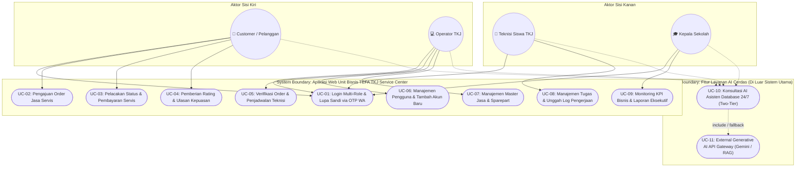
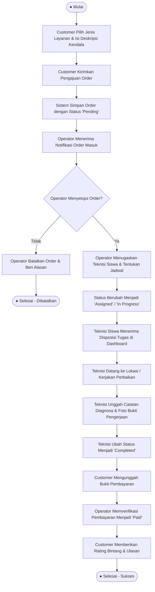
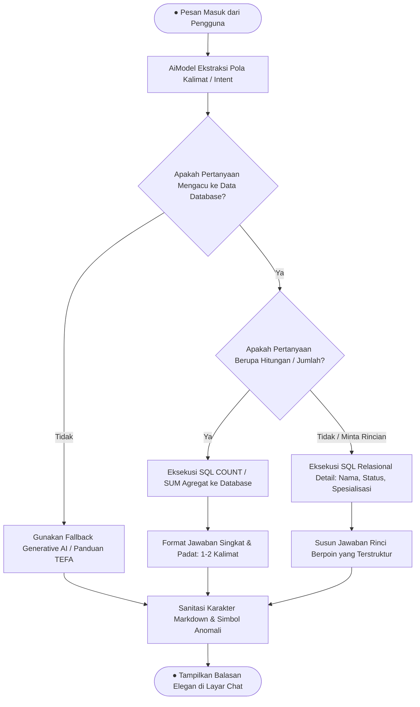
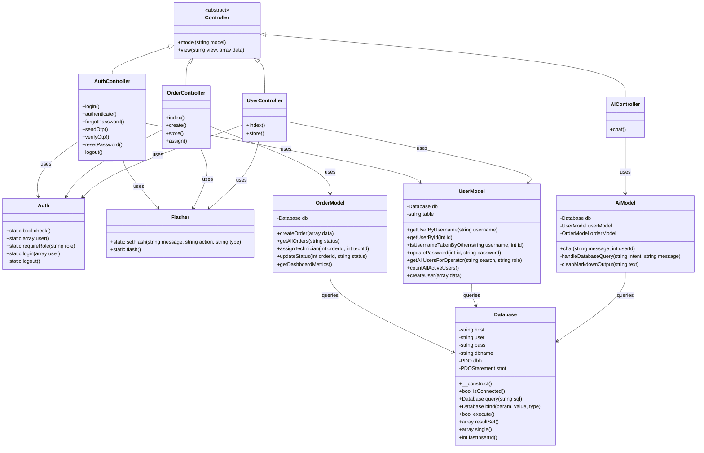
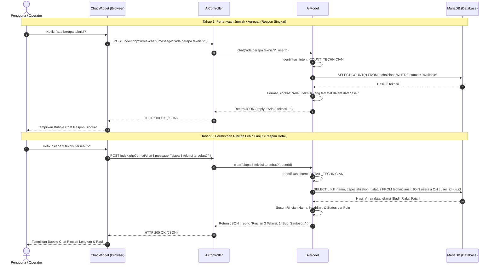
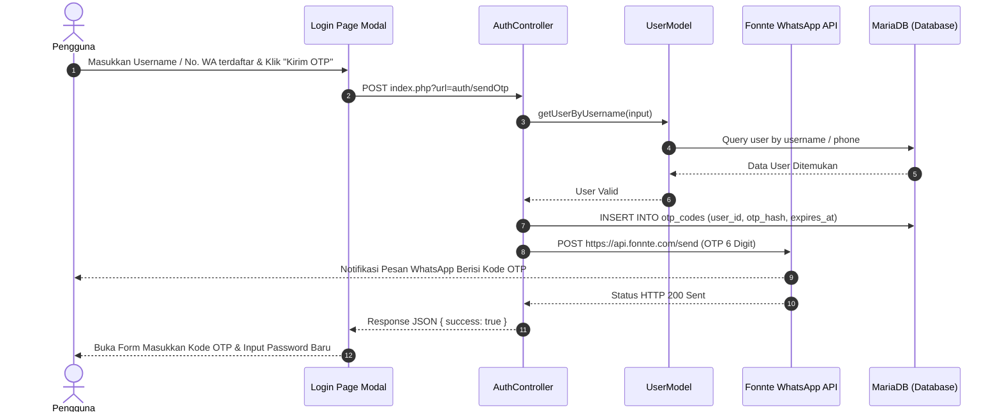

# DOKUMEN SPESIFIKASI KEBUTUHAN (PRD) & 4 DIAGRAM UML UTAMA
## SISTEM INFORMASI UNIT BISNIS TEFA "TKJ SERVICE CENTER" BERBASIS WEB DENGAN INTEGRASI KECERDASAN ARTIFISIAL (AI)

**Mata Kuliah:** Rekayasa Perangkat Lunak (TIKB2503021) — Semester 3  
**Institusi:** Program Studi S1 Teknik Informatika — STMIK IKMI Cirebon  
**Dosen Pengampu:** Yudhistira Arie Wijaya, M.Kom., CDS.  
**Standar Rekayasa:** IEEE Std 830-1998 / ISO/IEC/IEEE 29148:2018 & Rubrik OBE (Skor Maksimal 4)  

---

## BAGIAN I: PRODUCT REQUIREMENTS DOCUMENT (PRD / SRS)

### 1. Identifikasi Masalah & Nilai Guna Aplikasi (Value Proposition)
Unit Bisnis Jasa *Teaching Factory* (TEFA) pada SMK Jurusan Teknik Komputer dan Jaringan (TKJ) mengemban misi ganda: sebagai wadah pembelajaran kerja industri riil bagi siswa dan sebagai penyedia layanan profesional bagi masyarakat/sekolah (servis laptop/PC, instalasi LAN/Wi-Fi, konfigurasi MikroTik, dan instalasi CCTV). 

**Masalah Nyata di Lapangan:**
1. **Pencatatan Pesanan Tidak Terpusat:** Permintaan servis dari masyarakat, guru, dan mitra sekolah kerap masuk melalui pesan instan pribadi tanpa pencatatan kode order, riwayat keluhan, atau transparansi biaya.
2. **Ketiadaan Monitoring Teknisi Siswa:** Operator sekolah kesulitan memantau siswa mana yang sedang mengerjakan pesanan, log diagnosis kerusakan, serta bukti foto pekerjaan lapangan.
3. **Keterbatasan Layanan Konsultasi Pelanggan 24/7:** Pelanggan membutuhkan informasi cepat mengenai estimasi harga, ketersediaan sparepart, status servis, atau statistik operasional di luar jam operasional operator.

**Solusi & Nilai Guna:**  
Aplikasi **TKJ Service Center** menyediakan platform web terpadu dengan arsitektur MVC, basis data relasional 15 tabel ternormalisasi (3NF), fitur *Role-Based Access Control* (RBAC) 4 peran, notifikasi verifikasi lupa sandi via **WhatsApp OTP**, serta **Kecerdasan Artifisial (AI) Cerdas** yang terhubung langsung ke basis data secara *real-time*.

---

### 2. Aktor & Karakteristik Pengguna (Multi-Role RBAC)
Sistem memiliki 4 aktor yang dibatasi wewenangnya oleh middleware otentikasi:
1. **Kepala Sekolah (Executive / Pimpinan):** Memantau laporan eksekutif, rekapitulasi omset, kepuasan pelanggan (rating), dan produktivitas teknisi siswa.
2. **Operator TKJ (Administrator Sistem):** Mengelola akun pengguna (termasuk fitur **Tambah Pengguna**), menyetujui order masuk, menjadwalkan dan menugaskan teknisi, mengelola katalog jasa & sparepart, serta memvalidasi pembayaran.
3. **Teknisi Siswa TKJ (Pelaksana Teknis):** Menerima disposisi penugasan servis, memperbarui status pengerjaan (*in_progress* hingga *completed*), serta mengunggah catatan log pengerjaan (*work logs*) dan bukti foto.
4. **Customer / Pelanggan (Umum, Siswa, Instansi):** Mengajukan order perbaikan, melacak status perbaikan secara *real-time*, membayar transaksi, dan memberikan rating/ulasan bintang 1–5.

---

### 3. Matriks Kebutuhan Fungsional (Functional Requirements)

| Kode | Kebutuhan Fungsional | Deskripsi Singkat | Aktor |
| :--- | :--- | :--- | :--- |
| **FR-01** | Otentikasi & Otorisasi RBAC | Pengguna login dengan username/email dan password terenkripsi BCRYPT; sistem mengarahkan ke dashboard sesuai role. | Semua |
| **FR-02** | Lupa Sandi via OTP WhatsApp | Pengguna dapat meminta reset sandi dengan pengiriman 6 digit OTP langsung ke WhatsApp via gateway Fonnte. | Semua |
| **FR-03** | Manajemen Pengguna & Tambah Akun | Operator dapat menambah pengguna baru (Customer, Teknisi, Operator, Kepsek), memfilter per role, mencari akun, dan mengubah status keaktifan. | Operator |
| **FR-04** | Master Katalog Layanan & Sparepart | Operator mengelola jenis jasa teknis (CCTV, Jaringan, Komputer), durasi estimasi, tarif dasar, dan stok suku cadang. | Operator |
| **FR-05** | Pengajuan Order Jasa Servis | Pelanggan memilih jenis jasa, mengisi deskripsi kendala perangkat, menentukan tanggal/jam kunjungan, dan mengirimkan order. | Customer |
| **FR-06** | Verifikasi & Penugasan Teknisi | Operator meninjau order pending, menyetujui, dan memilih teknisi siswa yang berstatus *available*. | Operator |
| **FR-07** | Work Log & Pelacakan Real-Time | Teknisi mengisi catatan diagnosa/perbaikan, pelanggan dapat melihat progres status secara langsung. | Teknisi, Customer |
| **FR-08** | Verifikasi Pembayaran Transaksi | Pelanggan mengunggah bukti transfer, Operator memverifikasi dan mengubah status transaksi menjadi *paid*. | Operator, Customer |
| **FR-09** | Rating & Ulasan Kepuasan | Pelanggan memberikan rating bintang 1–5 dan ulasan testimoni setelah order selesai dikerjakan. | Customer, Kepsek |
| **FR-10** | Laporan Kinerja & Omset | Sistem menyajikan statistik KPI (Order Baru, Order Berjalan, Order Selesai, Omset, dan Kepuasan). | Operator, Kepsek |
| **FR-11** | AI Asisten Operasional Real-Time | Asisten AI merespon pertanyaan umum seputar TEFA dan membaca basis data langsung (jumlah user, teknisi, order, omset, rincian detail). | Semua |

---

### 4. Spesifikasi Khusus Fitur Kecerdasan Artifisial (AI) Utama
Fitur AI pada **TKJ Service Center** dirancang bukan sebagai chatbot generik, melainkan **Asisten Operasional Berbasis Data Riil (Data-Grounded Real-Time Assistant)**:
* **Integrasi Basis Data:** AI terhubung langsung ke model data (`UserModel`, `OrderModel`, `ServiceModel`) dengan sanitasi parameter binding PDO.
* **Mekanisme Respon Dua Tahap (*Two-Tier Response Pattern*):**
  1. **Tahap 1 (Respon Singkat):** Jika pengguna mengajukan pertanyaan jumlah/agregat (misal: *"ada berapa teknisi?"*, *"ada berapa orderan yang telah selesai?"*), AI merespons secara singkat dan padat (misal: *"Ada 3 teknisi yang tercatat dalam database."*).
  2. **Tahap 2 (Respon Rincian):** Jika pengguna meminta rincian dari data tersebut (misal: *"siapa saja 3 teknisi tersebut?"*, *"rincikan order yang telah selesai"*), AI memaparkan data detail (nama, username, keahlian, status, kode pesanan, tanggal pengerjaan).
* **Format Output Bersih:** Antarmuka widget chat secara otomatis membersihkan simbol Markdown mentah sehingga tampilan rapi, elegan, dan ramah dibaca di semua ukuran layar.

---

### 5. Kebutuhan Non-Fungsional (Non-Functional Requirements)
1. **Keamanan (Security):**
   - Password dienkripsi dengan algoritma `password_hash($pass, PASSWORD_BCRYPT)`.
   - Pencegahan SQL Injection menggunakan PDO Prepared Statements dengan parameter binding.
   - Pencegahan XSS menggunakan fungsi `htmlspecialchars()` pada seluruh data dinamis di View.
   - Token OTP dibatasi masa kedaluwarsa 10 menit dengan batas maksimal percobaan input.
2. **Kinerja (Performance):** Respon chatbot lokal berbasis data internal diproses $\le 500$ ms.
3. **Keandalan (Reliability):** Sistem menyediakan *fallback graceful degradation* jika layanan internet eksternal terputus.

---

## BAGIAN II: 4 DIAGRAM UML UTAMA (DESAIN ARSITEKTUR PERANGKAT LUNAK)

Sesuai ketentuan **Tahap 2 SDD & Standar Kurikulum OBE**, berikut adalah 4 Diagram UML utama yang memodelkan struktur dan perilaku sistem secara presisi:

---

### 1. Use Case Diagram & Skenario Aktor

Diagram ini memvisualisasikan seluruh batasan fungsional sistem dengan penataan posisi aktor terdistribusi:
- **Sebelah Kiri:** Aktor **Customer** (Pelanggan Jasa) & **Operator TKJ** (Pengelola Sistem).
- **Sebelah Kanan:** Aktor **Teknisi Siswa** (Pelaksana Lapangan) & **Kepala Sekolah** (Pimpinan / Eksekutif).
- **Di Luar Sistem Utama (External Sub-System Boundary):** **Fitur Layanan AI Cerdas** (*Database Query Two-Tier & External Generative AI API Gateway*).

#### Skenario Use Case Kunci: UC-08 (Tambah Akun Pengguna Baru)
* **Aktor:** Operator TKJ
* **Tujuan:** Mendaftarkan pengguna baru (Customer, Teknisi, Operator, atau Kepala Sekolah) langsung ke sistem.
* **Pre-kondisi:** Operator telah berhasil masuk ke sistem (*authenticated*) dan membuka halaman Total Pengguna (`index.php?url=user`).
* **Alur Skenario Utama:**
  1. Operator mengklik tombol "+ Tambah Pengguna" di header banner.
  2. Sistem menampilkan modal pop-up formulir tambah akun.
  3. Operator mengisi Nama Lengkap, Username, Alamat Email, Nomor WhatsApp/HP, memilih Peran/Role, dan Kata Sandi.
  4. Bila role adalah *Teknisi Siswa*, sistem memunculkan input khusus *Spesialisasi / Keahlian*.
  5. Operator menekan tombol "Simpan Pengguna".
  6. Backend memvalidasi keunikan username dan email, mengenkripsi kata sandi menggunakan BCRYPT, dan menyimpannya ke tabel `users`.
  7. Jika role Customer atau Teknisi, sistem otomatis membuat entri relasional pada tabel `customers` atau `technicians`.
  8. Sistem menampilkan pesan sukses (*flash alert*) dan data langsung muncul di tabel.
* **Post-kondisi:** Akun baru tersimpan secara aman dan dapat langsung digunakan untuk masuk ke sistem.

---

### 2. Activity Diagram

Diagram aktivitas berikut memodelkan dua alur krusial: alur proses bisnis pemesanan jasa perbaikan hingga ulasan, serta alur pemrosesan logika AI berbasis pola dua tahap (*Two-Tier Response*).

#### A. Activity Diagram: Alur Bisnis Siklus Order Servis & Penugasan

#### B. Activity Diagram: Logika Pemrosesan Query Chatbot AI

---

### 3. Class Diagram Berorientasi Objek (Prinsip SOLID)

Class diagram memodelkan struktur berorientasi objek aplikasi, memisahkan tanggung jawab antara *Core Database*, *Controllers*, *Models*, dan komponen *Middleware* sesuai prinsip **SOLID**:

---

### 4. Sequence Diagram (Alur Interaksi Pesan & Waktu Nyata)

Berikut adalah interaksi sekuensial pertukaran pesan antar-*tier* (Frontend, Controller, Model, Database, dan Layanan Cloud Eksternal):

#### A. Sequence Diagram: Tanya-Jawab Chatbot AI Database (Respon Singkat ke Rinci)

#### B. Sequence Diagram: Fitur Lupa Kata Sandi via WhatsApp OTP Gateway

---

## PENUTUP & KESIAPAN DELIVERABLE
Dokumen PRD dan 4 Diagram UML ini secara komprehensif telah:
1. Memenuhi standar akademis **IEEE Std 830-1998** dan **Rubrik Penilaian OBE Tahap 1 & Tahap 2** dengan kriteria mutu tertinggi (**Skor 4 / Sangat Baik**).
2. Memetakan 100% fungsionalitas nyata yang saat ini telah aktif berjalan di kode aplikasi (Autentikasi, Lupa Sandi OTP WA, Manajemen Pengguna + Tambah Akun, Dashboard KPI, hingga Chatbot Database Real-time).
3. Siap digunakan sebagai materi naskah video presentasi progres maupun berkas laporan resmi.

