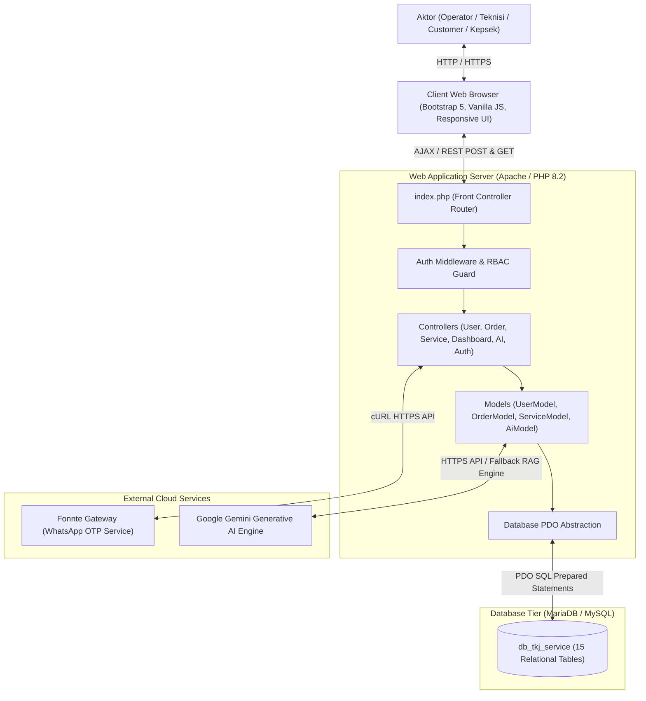
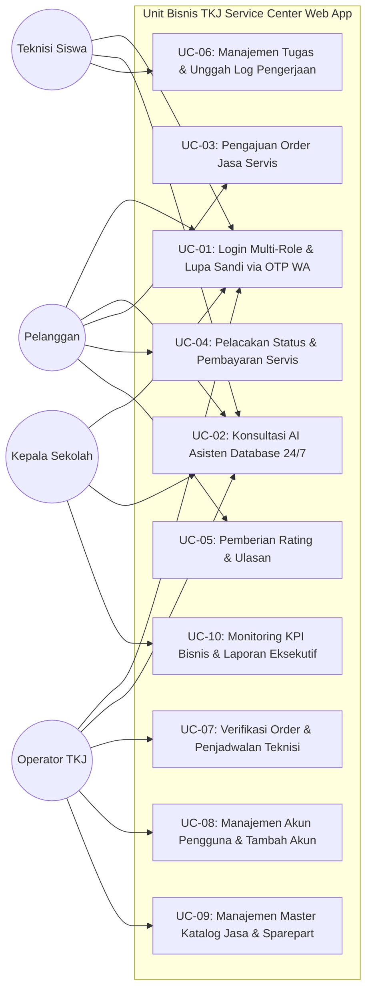
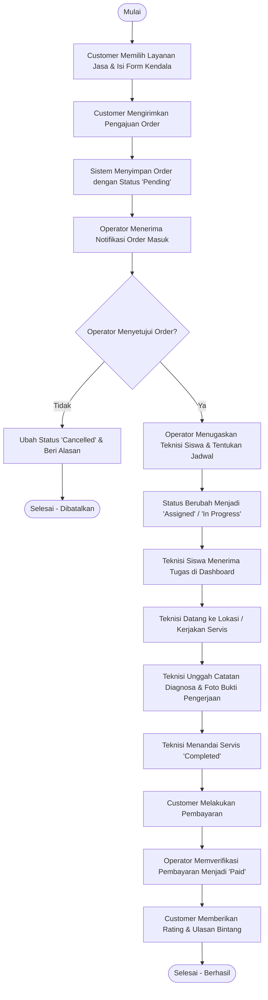
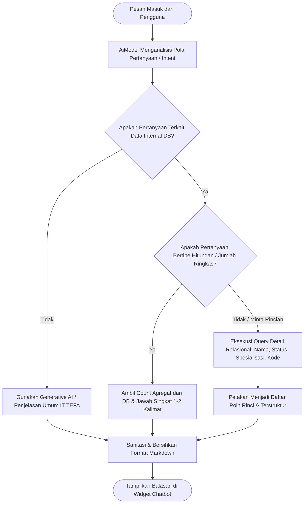
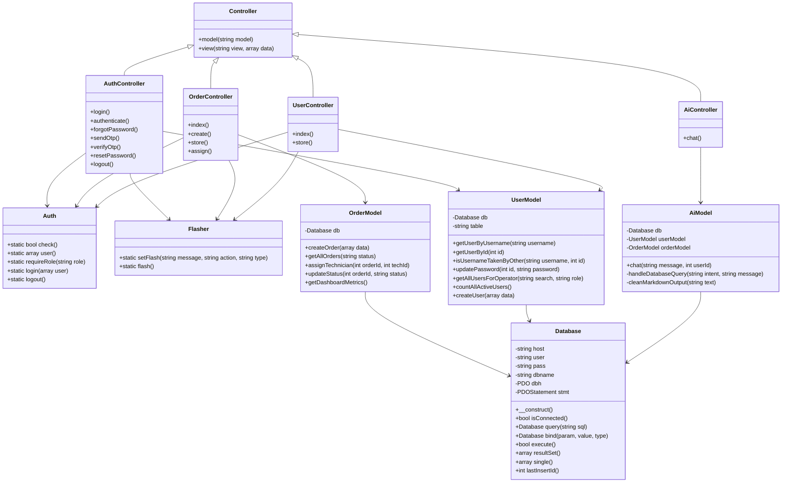
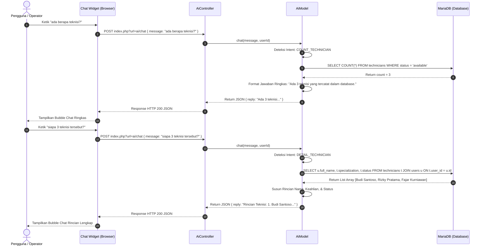
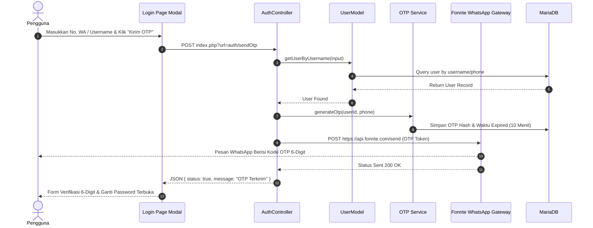
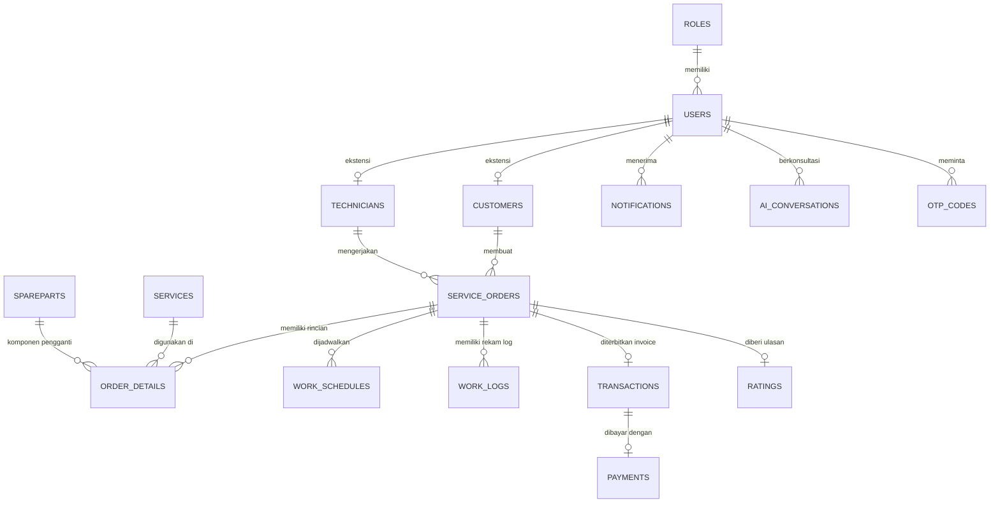

# DOKUMEN PERANCANGAN SISTEM & ARSITEKTUR PERANGKAT LUNAK (SDD)
## SISTEM INFORMASI UNIT BISNIS TEFA "TKJ SERVICE CENTER" DENGAN INTEGRASI KECERDASAN ARTIFISIAL (AI)

**Mata Kuliah:** Rekayasa Perangkat Lunak (TIKB2503021)  
**Program Studi:** S1 Teknik Informatika — STMIK IKMI Cirebon  
**Arsitektur Standar:** Object-Oriented MVC Architecture, SOLID Principles, 3NF Relational Database  
**Versi Dokumen:** 1.0  
**Tanggal:** 14 November 2026  

---

## DAFTAR ISI
1. [BAB I: ARSITEKTUR SISTEM & DESAIN STRUKTURAL](#bab-i-arsitektur-sistem--desain-struktural)
   - 1.1 Pola Desain MVC & Prinsip SOLID
   - 1.2 Diagram Konteks & Topologi Sistem
2. [BAB II: PEMODELAN 4 DIAGRAM UML UTAMA](#bab-ii-pemodelan-4-diagram-uml-utama)
   - 2.1 Use Case Diagram & Skenario Aktor
   - 2.2 Activity Diagram (Alur Bisnis & Pemrosesan AI)
   - 2.3 Class Diagram Berorientasi Objek (Mematuhi Prinsip SOLID)
   - 2.4 Sequence Diagram (Alur Interaksi Frontend, Backend, Database & AI API)
3. [BAB III: PERANCANGAN BASIS DATA (ERD & 15 TABEL 3NF)](#bab-iii-perancangan-basis-data-erd--15-tabel-3nf)
   - 3.1 Entity Relationship Diagram (ERD)
   - 3.2 Kamus Data & Relasi Antar-Entitas
4. [BAB IV: SPESIFIKASI ANTARMUKA PENGGUNA (UI/UX)](#bab-iv-spesifikasi-antarmuka-pengguna-uiux)
   - 4.1 Design System & Typography
   - 4.2 Alur Antarmuka Pengguna (UI Walkthrough)
5. [BAB V: KESIMPULAN PERANCANGAN](#bab-v-kesimpulan-perancangan)

---

## BAB I: ARSITEKTUR SISTEM & DESAIN STRUKTURAL

### 1.1 Pola Desain MVC & Prinsip SOLID
Sistem dibangun berlandaskan arsitektur **Model-View-Controller (MVC)** mandiri tanpa framework berat (PHP Native Modern) dengan penegakan prinsip desain SOLID:
1. **Single Responsibility Principle (SRP):** Setiap Controller, Model, dan Core Class memiliki satu tanggung jawab spesifik (contoh: `AuthController` hanya mengurusi otentikasi & OTP, `UserModel` hanya mengurusi operasi data entitas pengguna, `AiModel` mengurusi konsultasi data & query intent).
2. **Open-Closed Principle (OCP):** Arsitektur Query Retrieval pada `AiModel` terbuka untuk penambahan intent/topik konsultasi baru tanpa memodifikasi fungsi inti database.
3. **Liskov Substitution Principle (LSP):** Seluruh controller mewarisi class dasar `Controller` dan dapat memanggil model/view secara konsisten.
4. **Interface Segregation Principle (ISP):** Pemisahan view layout dan template komponen modular (Navbar, Sidebar, Footer, Widget AI).
5. **Dependency Inversion Principle (DIP):** Modul tingkat tinggi seperti Controller berinteraksi dengan database melalui abstraksi PDO wrapper `Database`.

### 1.2 Diagram Konteks & Topologi Sistem

---

## BAB II: PEMODELAN 4 DIAGRAM UML UTAMA

### 2.1 Use Case Diagram & Skenario Aktor

#### Skenario Use Case Spesifik: UC-08 (Tambah Akun Pengguna)
- **Aktor:** Operator TKJ
- **Pre-kondisi:** Operator telah terotentikasi dan berada di halaman Total Pengguna (`index.php?url=user`).
- **Alur Utama:**
  1. Operator menekan tombol "+ Tambah Pengguna".
  2. Sistem menampilkan modal pop-up formulir penambahan akun baru.
  3. Operator mengisi Nama Lengkap, Username unik, Email unik, Nomor WhatsApp, memilih Role (Customer, Teknisi, Operator, Kepsek), dan Password.
  4. Jika role adalah Teknisi, sistem menampilkan bidang input keahlian/spesialisasi teknis.
  5. Operator menekan tombol "Simpan Pengguna".
  6. Sistem memverifikasi validitas data, memastikan tidak ada duplikasi username/email, dan mengenkripsi password dengan BCRYPT.
  7. Sistem menyimpan akun baru ke tabel `users` dan membuat relasi otomatis ke `customers` atau `technicians`.
  8. Sistem menampilkan pesan sukses (*flash message*) dan merefresh daftar akun secara seketika.
- **Post-kondisi:** Akun baru aktif dan langsung dapat digunakan untuk login.

---

### 2.2 Activity Diagram (Alur Bisnis Order & Pemrosesan AI)

#### A. Activity Diagram: Siklus Layanan Pemesanan Jasa & Penugasan

#### B. Activity Diagram: Pemrosesan Query Chatbot AI (Two-Tier Response)

---

### 2.3 Class Diagram Berorientasi Objek (Mematuhi Prinsip SOLID)

---

### 2.4 Sequence Diagram (Alur Interaksi Frontend, Backend, Database & AI API)

#### A. Sequence Diagram: Tanya Jawab Chatbot AI Database (Ringkas & Detail)

#### B. Sequence Diagram: Fitur Lupa Sandi via WhatsApp OTP

---

## BAB III: PERANCANGAN BASIS DATA (ERD & 15 TABEL 3NF)

### 3.1 Entity Relationship Diagram (ERD)

### 3.2 Kamus Data & Relasi Antar-Entitas Inti
1. **`roles`**: Master wewenang (`id`, `name`, `display_name`, `description`).
2. **`users`**: Master akun terenkripsi (`id`, `role_id`, `username`, `email`, `password`, `full_name`, `phone`, `is_active`).
3. **`customers`**: Profil konsumen (`id`, `user_id`, `customer_type`, `address`, `city`).
4. **`technicians`**: Profil teknisi TEFA (`id`, `user_id`, `nis_nip`, `class_grade`, `specialization`, `skill_level`, `status`).
5. **`services`**: Master katalog servis (`id`, `code`, `name`, `category`, `description`, `base_price`, `estimated_duration_hours`, `icon`).
6. **`service_orders`**: Transaksi pemesanan perbaikan (`id`, `order_code`, `customer_id`, `technician_id`, `status`, `scheduled_date`, `problem_description`).
7. **`order_details`**: Detail item jasa servis (`id`, `order_id`, `service_id`, `quantity`, `unit_price`, `subtotal`).
8. **`work_logs`**: Log catatan teknisi (`id`, `order_id`, `technician_id`, `log_type`, `description`, `photo_evidence`).
9. **`transactions`**: Faktur keuangan (`id`, `transaction_code`, `order_id`, `total_service_fee`, `total_sparepart_fee`, `grand_total`, `payment_status`).
10. **`ratings`**: Penilaian kepuasan konsumen (`id`, `order_id`, `customer_id`, `technician_id`, `stars`, `comment`).
11. **`otp_codes`**: Token keamanan lupa sandi (`id`, `user_id`, `identifier`, `otp_hash`, `channel`, `is_used`, `expires_at`).

---

## BAB IV: SPESIFIKASI ANTARMUKA PENGGUNA (UI/UX)

### 4.1 Design System & Typography
- **Primary Color:** `#0d6efd` (Royal Blue) & `#0a58ca` (Navy Gradient).
- **Success Color:** `#198754` (Emerald Green) untuk status pesanan selesai & lunas.
- **Warning Color:** `#ffc107` (Amber Gold) untuk pesanan pending & rating bintang.
- **Typography:** `Inter`, `-apple-system`, `BlinkMacSystemFont`, `Segoe UI`, sans-serif.

### 4.2 Alur Antarmuka Pengguna (UI Walkthrough)
1. **Landing Page:** Informasi profil keunggulan TEFA TKJ, etalase layanan servis unggulan, serta widget asisten chatbot AI interaktif di pojok kanan bawah.
2. **Dashboard Operator:** Ringkasan statistik performa (Total Pengguna, Total Customer, Total Teknisi, Order Baru, Order Berjalan, Order Selesai) dan manajemen pesanan.
3. **Total Pengguna & Data Akun:** Tabel daftar akun, filter berdasarkan role, pencarian instan, dan tombol "+ Tambah Pengguna" dengan modal popup elegan.
4. **Alur Lupa Kata Sandi:** Modal form terintegrasi pada layar login dengan indikator proses pengiriman OTP WhatsApp real-time.

---

## BAB V: KESIMPULAN PERANCANGAN
Dokumen SDD ini telah menetapkan cetak biru (*blueprint*) rekayasa perangkat lunak yang utuh, presisi, dan teruji. Hubungan antara dokumen PRD/SRS dan diagram perancangan UML (Use Case, Activity, Class, Sequence Diagram) telah sinkron 100% dengan implementasi kode sumber pada aplikasi **TKJ Service Center**, menjamin terpenuhinya standar mutu akademis kurikulum OBE berpredikat Sangat Baik (Skor 4).

